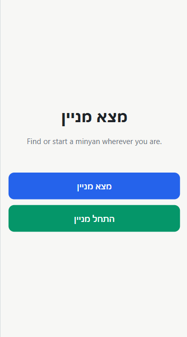
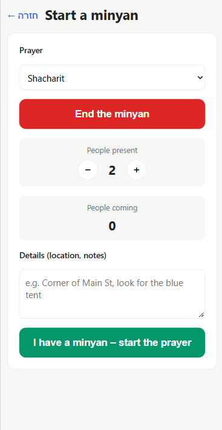

מצא את המניין#
שלום
 ברוכים הבאים לאפליקציית "מצא לי מניין". מטרת  האפליקציה היא לעזור למשתמשים לארגן ולמצוא מניינים כמה שיותר מהר.
האפליקציה יכולה להכיל מידע לגבי התפילה המתעתדת (נוסח, קצר\ארוך או כל פרט נוסף שמארגן המניין יכול לחשוב עליו).
 הדף הראשון של האפליקציה הוא דף תפריט שמאפשר למשתמש לבחור האם להוסיף מניין חדש או לחפש מניין קיים

 בחלון "התחל מניין" יש אפשרות להתחיל\לסיים מניין, לכתוב את הפרטים עליו בקופסת טקסט ולהוסיף\ אליו\ להחסיר ממנו מתפללים, וניתן ללחוץ על כפתור שאומר אם כבר התחילו להתפלל, בנוסף יש קופסת בחירה שמאפשרת לבחור באיזו תפילה מדובר" 
 ברגע שמשתמש לחץ על כפתור התחלת מניין נשלח שדר לשרת שמפרט את מיקום השרת המניין, על בסיס מיקום הפלאפון.

 חלון "הצטרף למניין"  מאפשר למשתמש לראות על מפה אילו מניינים מתרחשים עכשיו בסביבתו של המשתמש. המשתמש בוחר טווח שאותו הוא מוכן ללכת ועל המפה מופיעים  סמנים שמראים לו איפה המניין נמצא.כרגע המניינים מסומנים בככחול והמשתמש מסומן בירוק. 
 [הלוגו שלי](images/lookminyan.png)
 כשלוחצים על סמן של מניין אתה רשום כמצטרף עתידי ומארגן המניין מקבל הודעה שמישהו מצטרף.
 קיים מנגנון למחיקת תפילות שעבר זמן רב מדי מאז תחילתן כך שלא תופענה על חלון השימוש.

 
 האפליקציה נכתבה באמצעות Claude Code,  הצד לקוח שלה כתוב ב React.js, הצד שרת שלה כתוב בNode.js,  ומסד הנתונים שלה הוא בPostgresql.
הצגת המפה מתבצעת באמצעות maplibre

הרחבות אפשריות לאפליקציה הן משימות ברורות  שמוחקות תפילות שעבר זמנן ותפילות שלא הגיוני שעדיין פעילות (כמו, לדוגמא, מניין אשכנזי שהתחיל להתפלל מנחה לפני יותר מחצי שעה ועדיין לא סיים)